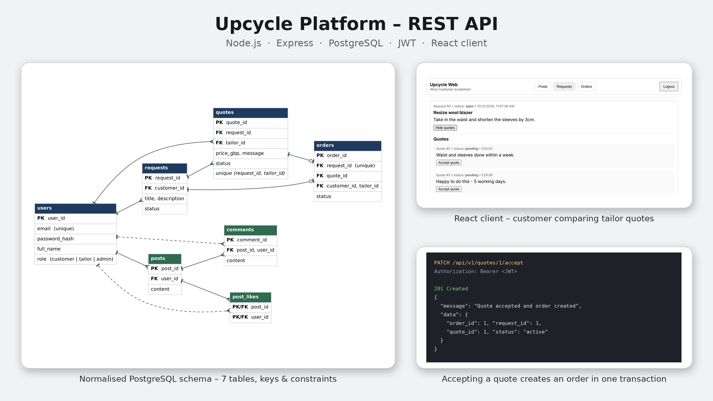
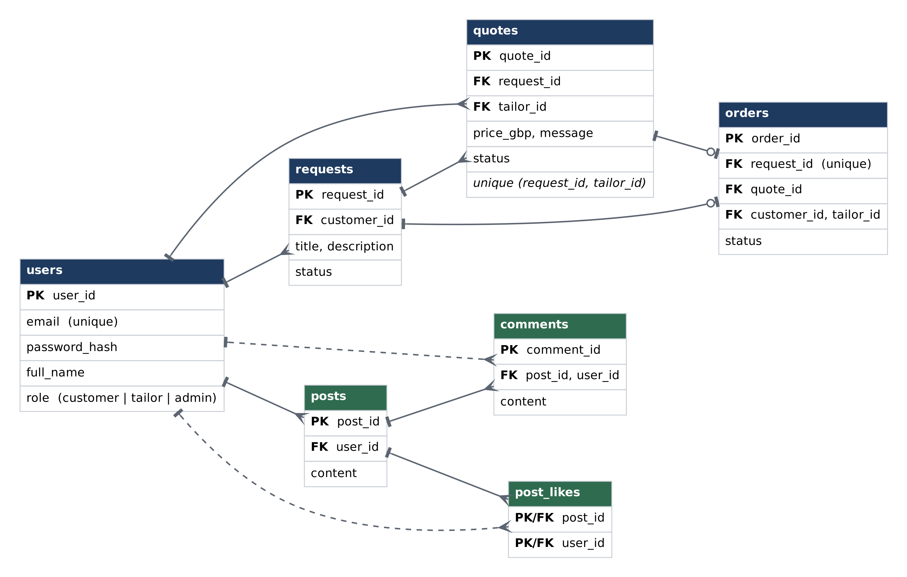

# Upcycle Platform – REST API

A marketplace API that connects customers who want clothing altered or upcycled with local tailors. Customers post requests, tailors submit quotes, and accepting a quote creates an order in a single database transaction. The platform also includes a small social feed with posts, comments and likes.

Built as a team project for the CMP5387 Backend Web Services and Database Engineering module at Birmingham City University.



## Tech stack

- **API:** Node.js, Express 5
- **Database:** PostgreSQL (`pg`)
- **Auth & security:** JWT, bcrypt password hashing, role-based access control, Helmet, CORS
- **Validation:** Zod
- **Client:** React + Vite

## Features

- Registration and login with JWT, with three roles: `customer`, `tailor` and `admin`
- Request → quote → order workflow:
  - customers create service requests
  - tailors submit one quote per request
  - customers accept a quote, which creates the order and rejects the competing quotes atomically
  - tailors update order status
- Social feed with posts, comments and like toggling
- Consistent HTTP status codes (400, 401, 403, 404, 409)

## Database design

Seven tables in a normalised schema, enforced with primary, foreign, unique and check constraints (for example, one quote per tailor per request, and one order per request).



## API endpoints

All routes are prefixed with `/api/v1`.

| Method | Route | Access |
|---|---|---|
| POST | `/auth/register` | Public |
| POST | `/auth/login` | Public |
| GET | `/auth/me` | Signed in |
| GET | `/requests` | Signed in |
| POST | `/requests` | Customer |
| GET | `/requests/:id/quotes` | Signed in |
| POST | `/requests/:id/quotes` | Tailor |
| PATCH | `/quotes/:quoteId/accept` | Customer |
| GET | `/orders` | Signed in |
| GET | `/orders/:id` | Signed in |
| PATCH | `/orders/:id/status` | Tailor, Admin |
| GET | `/posts` | Public |
| POST | `/posts` | Signed in |
| GET | `/posts/:postId/comments` | Public |
| POST | `/posts/:postId/comments` | Signed in |
| POST | `/posts/:postId/likes` | Signed in |

## Running locally

Requirements: Node.js 20+ and PostgreSQL.

```bash
# 1. Database
createdb upcycle_db
psql -d upcycle_db -f api/sql/schema.sql

# 2. API
cd api
cp .env.example .env      # then fill in your database details and a JWT secret
npm install
npm run dev               # http://localhost:3000

# 3. Web client
cd ../web
npm install
npm run dev               # http://localhost:5173
```

Create users through `POST /api/v1/auth/register` or the web client. The passwords in `sql/seed.sql` are placeholders, so seeded users can't log in.

## Team

Socrates Viegas, Kwaku Koduah, Aadam Wasim, Sawmiya Ravindra Kumar and Nabiil Ismail.
